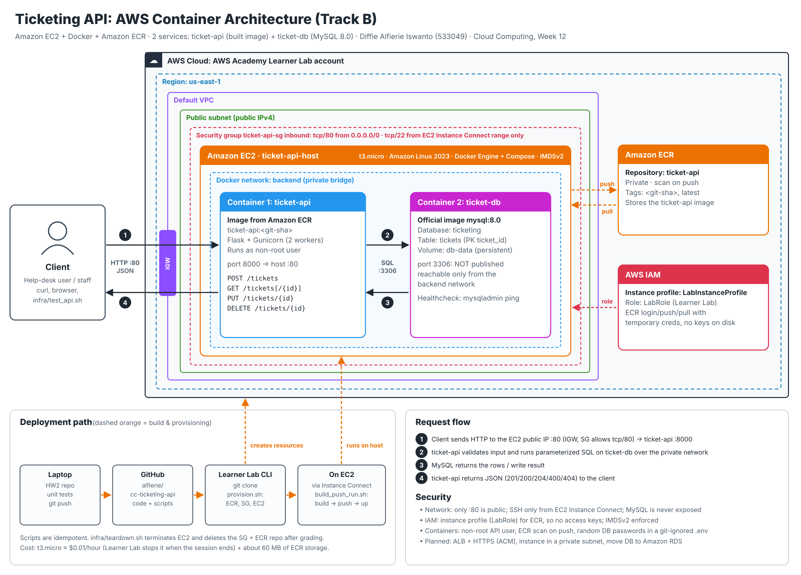

# Ticketing API on AWS Serverless

**Course:** Cloud Computing, Individual Project (Week 12: Design & AWS Setup)
**Student:** Diffie Alfierie Iswanto (533049)
**Track:** C, Serverless (API Gateway + Lambda + DynamoDB)
**AWS environment:** personal AWS account (Free plan, `us-east-1`), because AWS Academy Learner Lab access wasn't available at the time of Week 12

A small help-desk ticketing backend: users submit tickets (e.g. "projector in room E6 not working"),
and staff read, update the status of, and close them. It exposes a REST-style JSON API with full CRUD on one entity, `Ticket`.

## Architecture

```
Client (curl / browser)
   │  HTTPS
   ▼
Amazon API Gateway (HTTP API, $default stage, CORS)
   │  AWS_PROXY integration, payload v2.0
   ▼
AWS Lambda  tickets-api-fn  (Python 3.12, role: tickets-api-lambda-role)
   │  boto3 PutItem / Scan / GetItem / UpdateItem / DeleteItem
   ▼
Amazon DynamoDB  Tickets  (PK: ticketId, on-demand)

Lambda logs ──► Amazon CloudWatch Logs
```



The labeled diagram above shows the data flow (steps 1–6), IAM, the network boundary, and the deployment path.

## Data entity: `Ticket`

| Field | Type | Notes |
|---|---|---|
| `ticketId` | string (UUID) | Partition key, generated by the server |
| `title` | string | Required |
| `description` | string | Optional |
| `status` | enum | `OPEN` (default), `IN_PROGRESS`, `RESOLVED`, `CLOSED` |
| `priority` | enum | `LOW`, `MEDIUM` (default), `HIGH` |
| `requesterName` | string | Required |
| `createdAt` / `updatedAt` | ISO-8601 string | Set by the server |

## Endpoints

| CRUD | Method & path | Success | Errors |
|---|---|---|---|
| Create | `POST /tickets` | 201 + ticket | 400 validation |
| Read | `GET /tickets` (list), `GET /tickets/{id}` | 200 | 404 |
| Update | `PUT /tickets/{id}` (partial fields) | 200 + updated ticket | 400, 404 |
| Delete | `DELETE /tickets/{id}` | 204 | 404 |

Example:
```bash
curl -X POST "$API_URL/tickets" -H 'Content-Type: application/json' \
  -d '{"title":"Wi-Fi down in lab","requesterName":"Diffie","priority":"HIGH"}'
```

## Repository layout

```
src/app.py          Lambda handler (routing, validation, DynamoDB access)
tests/test_app.py   Unit tests with an in-memory fake table (no AWS needed)
infra/config.sh     Names and region shared by the scripts
infra/deploy.sh     Idempotent provisioning with the AWS CLI (table, IAM role, function, API)
infra/iam/          Trust policy + least-privilege access policy for the Lambda role
infra/test_api.sh   End-to-end connectivity test of every route
infra/teardown.sh   Deletes all resources, including the IAM role and log group
docs/               Deployment plan, architecture diagram, evidence screenshots
```

## Run the tests locally

```bash
python3 -m unittest discover -s tests -v
```

## Deploy

Full walkthrough: [`docs/deployment-plan.md`](docs/deployment-plan.md). In short:

1. Sign in to the AWS console as an IAM admin user, set the region to `us-east-1`, and open **CloudShell**.
2. `git clone https://github.com/alfierie/cc-ticketing-api.git && cd cc-ticketing-api`
3. `bash infra/deploy.sh`: creates the table, the IAM role, the function, and the API, then prints the base URL
4. `bash infra/test_api.sh`: runs the full CRUD cycle against the live API
5. When finished: `bash infra/teardown.sh`

## Security notes

- **IAM:** the Lambda execution role `tickets-api-lambda-role` ([`infra/iam/`](infra/iam)) is trusted only by `lambda.amazonaws.com`.
  It can only call `dynamodb:PutItem/GetItem/Scan/UpdateItem/DeleteItem` on the `Tickets` table ARN and write to its own
  `/aws/lambda/tickets-api-fn` log group. Deployment runs from CloudShell as an IAM admin user, with MFA on the root user.
- **Invoke permission:** a Lambda resource-based policy allows only this API's ARN (`execute-api:<api-id>/*/*`) to invoke the function.
- **Transport:** API Gateway serves HTTPS only. Input is validated with allow-listed fields and enums before it reaches DynamoDB.
- **Not in scope for Week 12:** authentication (planned: Amazon Cognito JWT authorizer on the HTTP API).
